<!-- Generated by build/render.py from build/content.json. Edit those, not this. -->

<a href="https://thefilip.com"><picture><source media="(max-width: 600px) and (prefers-color-scheme:dark)" srcset="cards/hero-dark-sm.webp"><source media="(max-width: 600px)" srcset="cards/hero-light-sm.webp"><source media="(prefers-color-scheme: dark)" srcset="cards/hero-dark.webp">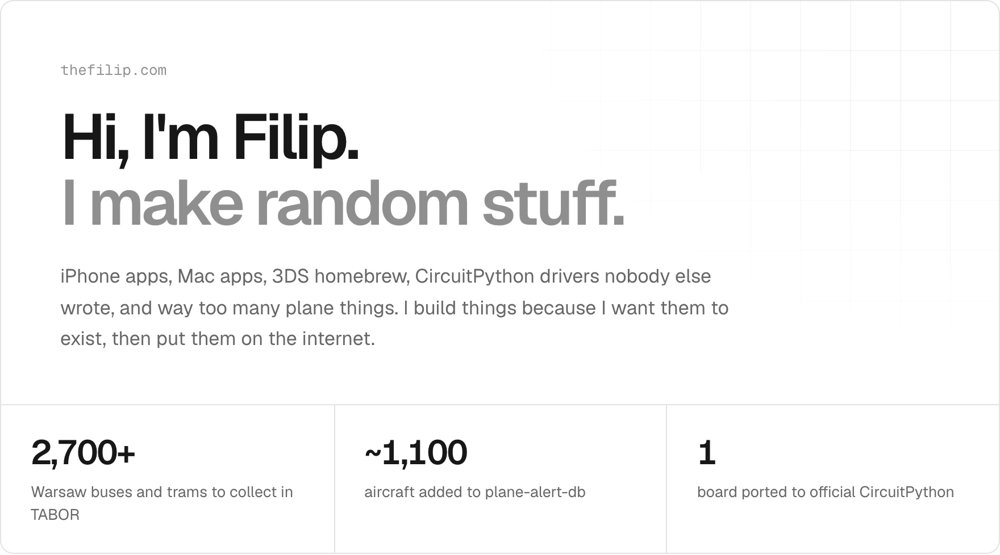</picture></a>

<a href="https://thefilip.com"><picture><source media="(prefers-color-scheme: dark)" srcset="cards/btn-site-dark.webp"></picture></a>
<a href="mailto:fm@thefilip.com"><picture><source media="(prefers-color-scheme: dark)" srcset="cards/btn-email-dark.webp"></picture></a>

 

<picture><source media="(max-width: 600px) and (prefers-color-scheme:dark)" srcset="cards/h-made-dark-sm.webp"><source media="(max-width: 600px)" srcset="cards/h-made-light-sm.webp"><source media="(prefers-color-scheme: dark)" srcset="cards/h-made-dark.webp">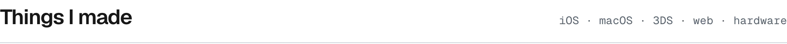</picture>

<a href="https://thefilip.com/projects/tabor"><picture><source media="(max-width: 600px) and (prefers-color-scheme:dark)" srcset="cards/tabor-dark-sm.webp"><source media="(max-width: 600px)" srcset="cards/tabor-light-sm.webp"><source media="(prefers-color-scheme: dark)" srcset="cards/tabor-dark.webp">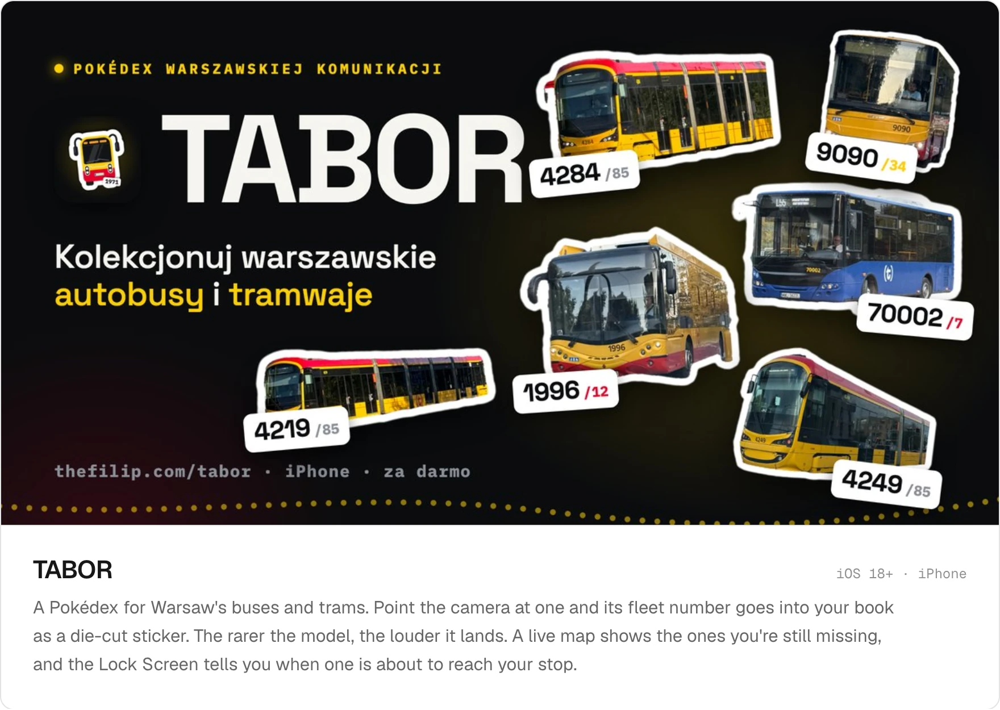</picture></a>

<a href="https://thefilip.com/projects/tabor/install"><picture><source media="(prefers-color-scheme: dark)" srcset="cards/btn-testflight-dark.webp"></picture></a>
<a href="https://github.com/TheFilipcom4607/tabor"><picture><source media="(prefers-color-scheme: dark)" srcset="cards/btn-tabor-source-dark.webp"></picture></a>
<a href="https://thefilip.com/tabor"><picture><source media="(prefers-color-scheme: dark)" srcset="cards/btn-tabor-pl-dark.webp"></picture></a>

<a href="https://thefilip.com/projects/wattson/install"><picture><source media="(max-width: 600px) and (prefers-color-scheme:dark)" srcset="cards/wattson-dark-sm.webp"><source media="(max-width: 600px)" srcset="cards/wattson-light-sm.webp"><source media="(prefers-color-scheme: dark)" srcset="cards/wattson-dark.webp">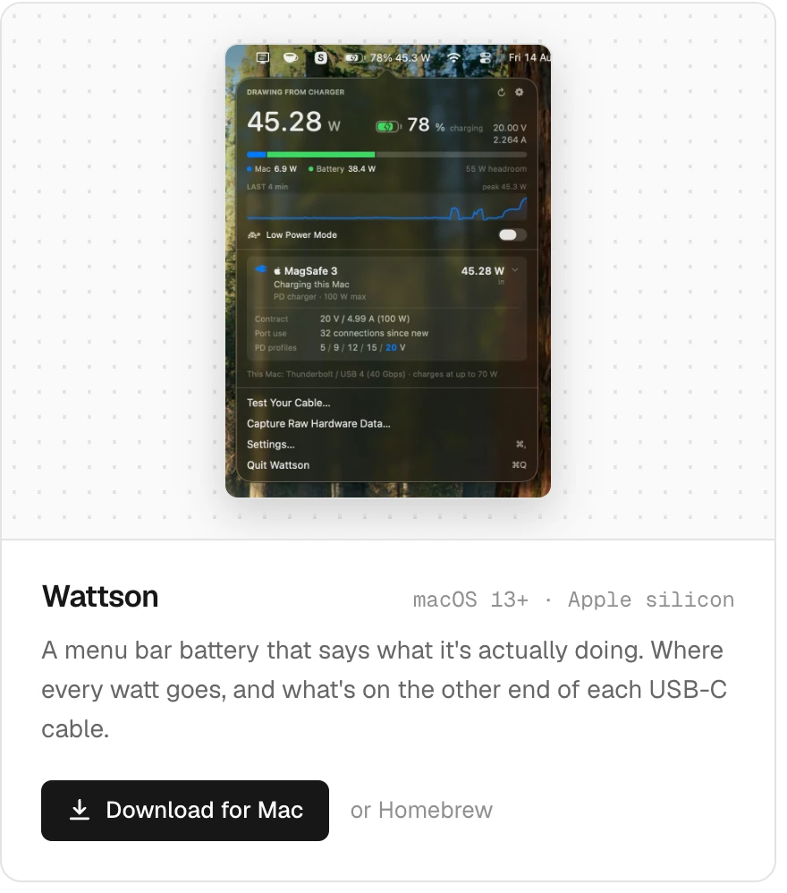</picture></a><a href="https://thefilip.com/projects/blockblast3ds/install"><picture><source media="(max-width: 600px) and (prefers-color-scheme:dark)" srcset="cards/blockblast-dark-sm.webp"><source media="(max-width: 600px)" srcset="cards/blockblast-light-sm.webp"><source media="(prefers-color-scheme: dark)" srcset="cards/blockblast-dark.webp">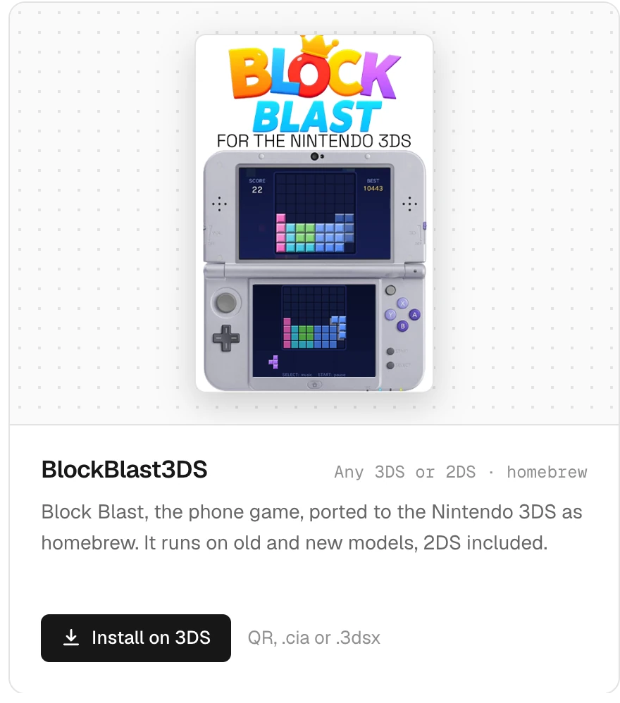</picture></a> 
<a href="https://thefilip.com/projects/ffmep/install"><picture><source media="(max-width: 600px) and (prefers-color-scheme:dark)" srcset="cards/ffmep-dark-sm.webp"><source media="(max-width: 600px)" srcset="cards/ffmep-light-sm.webp"><source media="(prefers-color-scheme: dark)" srcset="cards/ffmep-dark.webp">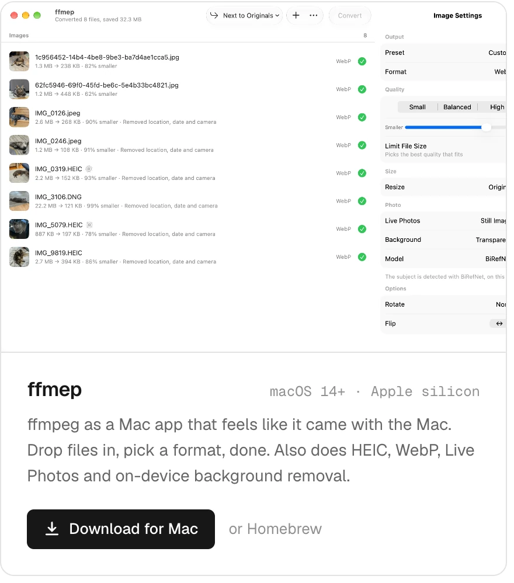</picture></a><a href="https://assets.thefilip.com/labeler"><picture><source media="(max-width: 600px) and (prefers-color-scheme:dark)" srcset="cards/labeler-dark-sm.webp"><source media="(max-width: 600px)" srcset="cards/labeler-light-sm.webp"><source media="(prefers-color-scheme: dark)" srcset="cards/labeler-dark.webp"></picture></a> 
<a href="https://thefilip.com/projects/ADSBnear"><picture><source media="(max-width: 600px) and (prefers-color-scheme:dark)" srcset="cards/adsbnear-dark-sm.webp"><source media="(max-width: 600px)" srcset="cards/adsbnear-light-sm.webp"><source media="(prefers-color-scheme: dark)" srcset="cards/adsbnear-dark.webp">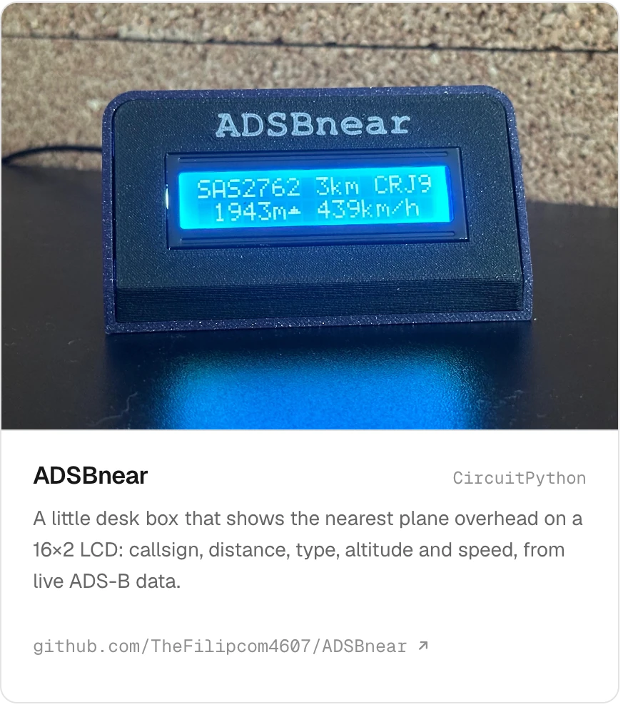</picture></a><a href="https://planeguessr.com"><picture><source media="(max-width: 600px) and (prefers-color-scheme:dark)" srcset="cards/planeguessr-dark-sm.webp"><source media="(max-width: 600px)" srcset="cards/planeguessr-light-sm.webp"><source media="(prefers-color-scheme: dark)" srcset="cards/planeguessr-dark.webp">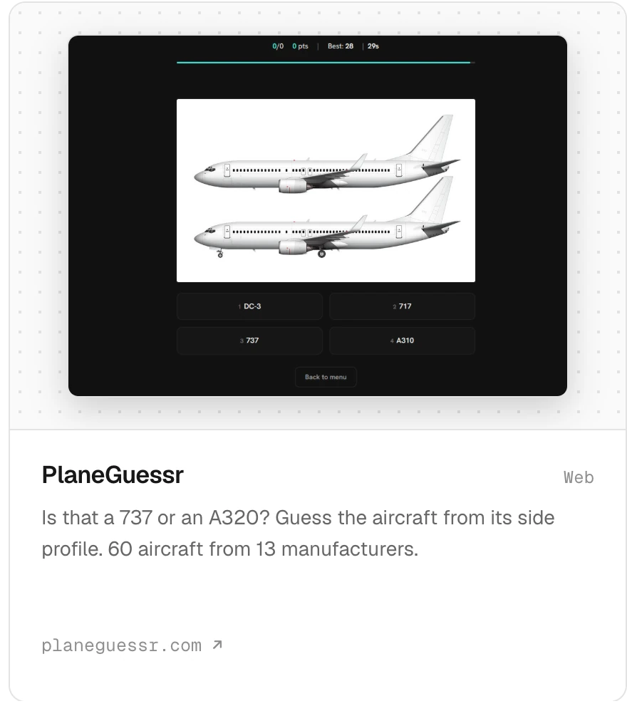</picture></a>

 

<picture><source media="(max-width: 600px) and (prefers-color-scheme:dark)" srcset="cards/h-oss-dark-sm.webp"><source media="(max-width: 600px)" srcset="cards/h-oss-light-sm.webp"><source media="(prefers-color-scheme: dark)" srcset="cards/h-oss-dark.webp">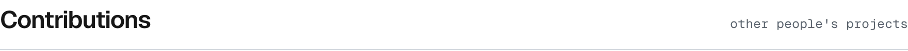</picture>

<a href="https://github.com/adafruit/circuitpython/pull/11321"><picture><source media="(max-width: 600px) and (prefers-color-scheme:dark)" srcset="cards/c-circuitpython-dark-sm.webp"><source media="(max-width: 600px)" srcset="cards/c-circuitpython-light-sm.webp"><source media="(prefers-color-scheme: dark)" srcset="cards/c-circuitpython-dark.webp">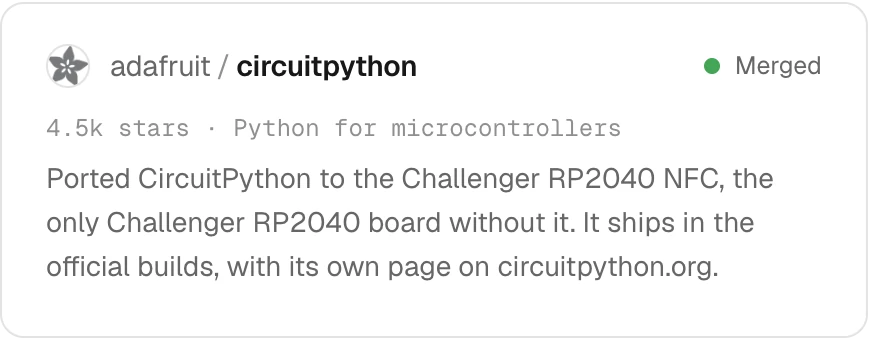</picture></a><a href="https://github.com/sdr-enthusiasts/plane-alert-db/pulls?q=is%3Apr+author%3ATheFilipcom4607+is%3Amerged"><picture><source media="(max-width: 600px) and (prefers-color-scheme:dark)" srcset="cards/c-planealert-dark-sm.webp"><source media="(max-width: 600px)" srcset="cards/c-planealert-light-sm.webp"><source media="(prefers-color-scheme: dark)" srcset="cards/c-planealert-dark.webp">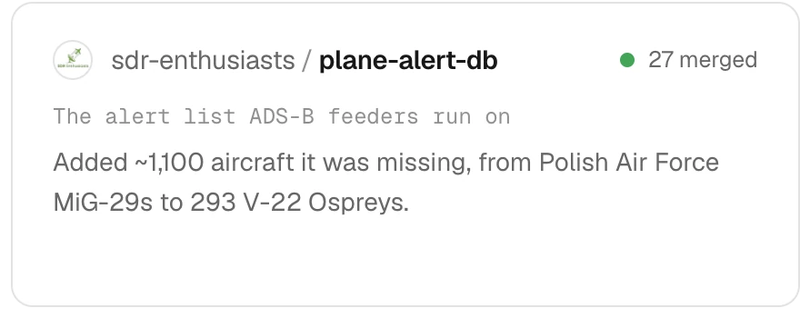</picture></a> 
<a href="https://github.com/can1357/oh-my-pi/pull/11740"><picture><source media="(max-width: 600px) and (prefers-color-scheme:dark)" srcset="cards/c-ohmypi-dark-sm.webp"><source media="(max-width: 600px)" srcset="cards/c-ohmypi-light-sm.webp"><source media="(prefers-color-scheme: dark)" srcset="cards/c-ohmypi-dark.webp">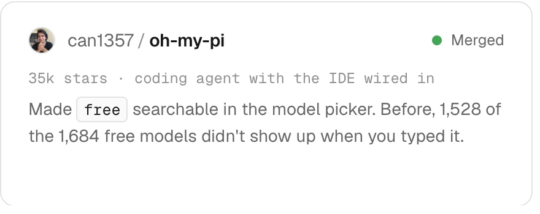</picture></a><a href="https://github.com/Kruszoneq/macUSB/pull/141"><picture><source media="(max-width: 600px) and (prefers-color-scheme:dark)" srcset="cards/c-macusb-dark-sm.webp"><source media="(max-width: 600px)" srcset="cards/c-macusb-light-sm.webp"><source media="(prefers-color-scheme: dark)" srcset="cards/c-macusb-dark.webp">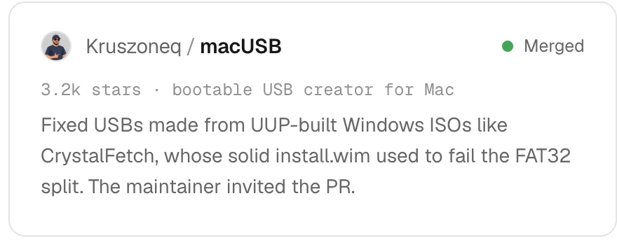</picture></a> 
<a href="https://github.com/safijari/openpuck/pull/224"><picture><source media="(max-width: 600px) and (prefers-color-scheme:dark)" srcset="cards/c-openpuck-dark-sm.webp"><source media="(max-width: 600px)" srcset="cards/c-openpuck-light-sm.webp"><source media="(prefers-color-scheme: dark)" srcset="cards/c-openpuck-dark.webp">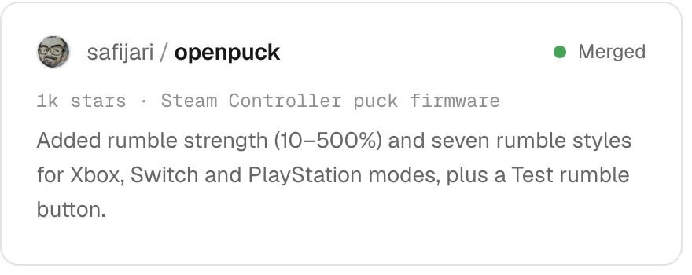</picture></a><a href="https://github.com/Universal-Team/db/pull/620"><picture><source media="(max-width: 600px) and (prefers-color-scheme:dark)" srcset="cards/c-udb-dark-sm.webp"><source media="(max-width: 600px)" srcset="cards/c-udb-light-sm.webp"><source media="(prefers-color-scheme: dark)" srcset="cards/c-udb-dark.webp">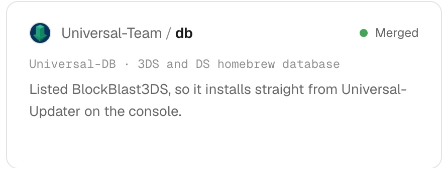</picture></a>

 

<picture><source media="(max-width: 600px) and (prefers-color-scheme:dark)" srcset="cards/h-also-dark-sm.webp"><source media="(max-width: 600px)" srcset="cards/h-also-light-sm.webp"><source media="(prefers-color-scheme: dark)" srcset="cards/h-also-dark.webp">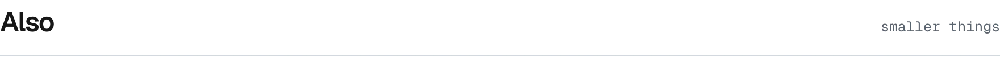</picture>

<a href="https://github.com/TheFilipcom4607/circuitpython-pn7150"><picture><source media="(max-width: 600px) and (prefers-color-scheme:dark)" srcset="cards/m-pn7150-dark-sm.webp"><source media="(max-width: 600px)" srcset="cards/m-pn7150-light-sm.webp"><source media="(prefers-color-scheme: dark)" srcset="cards/m-pn7150-dark.webp">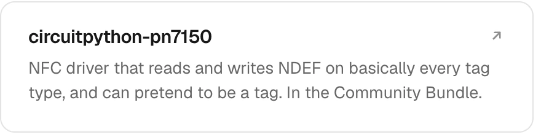</picture></a><a href="https://github.com/TheFilipcom4607/circuitpython-st25dv"><picture><source media="(max-width: 600px) and (prefers-color-scheme:dark)" srcset="cards/m-st25dv-dark-sm.webp"><source media="(max-width: 600px)" srcset="cards/m-st25dv-light-sm.webp"><source media="(prefers-color-scheme: dark)" srcset="cards/m-st25dv-dark.webp">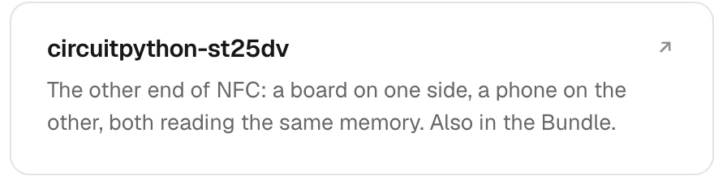</picture></a> 
<a href="https://thefilip.com/projects/funplaneviewer"><picture><source media="(max-width: 600px) and (prefers-color-scheme:dark)" srcset="cards/m-funplaneviewer-dark-sm.webp"><source media="(max-width: 600px)" srcset="cards/m-funplaneviewer-light-sm.webp"><source media="(prefers-color-scheme: dark)" srcset="cards/m-funplaneviewer-dark.webp"></picture></a><a href="https://thefilip.com/projects/magictimer"><picture><source media="(max-width: 600px) and (prefers-color-scheme:dark)" srcset="cards/m-magictimer-dark-sm.webp"><source media="(max-width: 600px)" srcset="cards/m-magictimer-light-sm.webp"><source media="(prefers-color-scheme: dark)" srcset="cards/m-magictimer-dark.webp">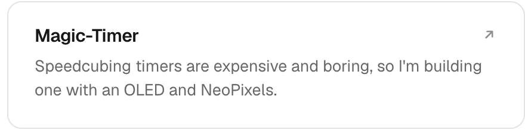</picture></a> 
<a href="https://getspaas.com"><picture><source media="(max-width: 600px) and (prefers-color-scheme:dark)" srcset="cards/m-spaas-dark-sm.webp"><source media="(max-width: 600px)" srcset="cards/m-spaas-light-sm.webp"><source media="(prefers-color-scheme: dark)" srcset="cards/m-spaas-dark.webp">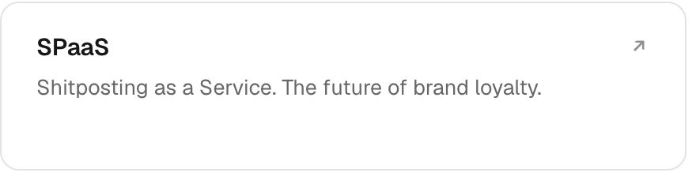</picture></a><a href="https://1610.uk"><picture><source media="(max-width: 600px) and (prefers-color-scheme:dark)" srcset="cards/m-1610-dark-sm.webp"><source media="(max-width: 600px)" srcset="cards/m-1610-light-sm.webp"><source media="(prefers-color-scheme: dark)" srcset="cards/m-1610-dark.webp">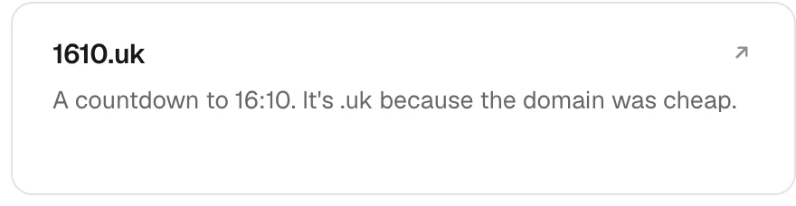</picture></a>

 

<a href="https://thefilip.com/projects"><picture><source media="(prefers-color-scheme: dark)" srcset="cards/btn-more-dark.webp">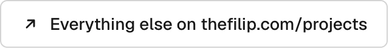</picture></a>

